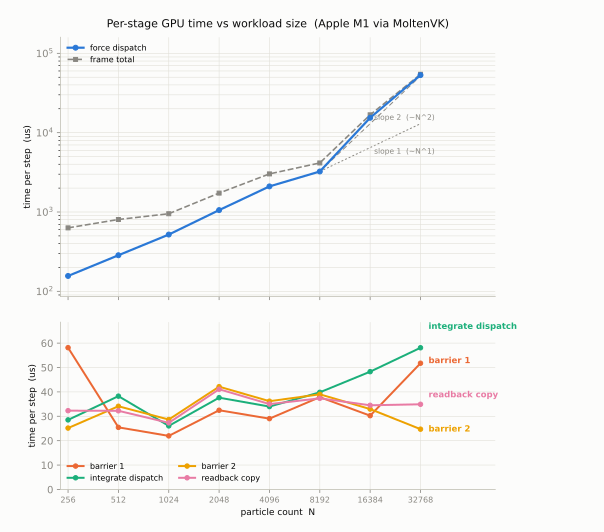
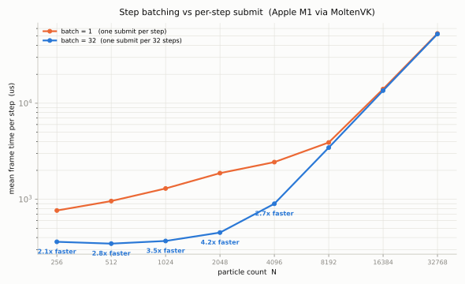

# GPU Compute Profiler (Vulkan)

A headless Vulkan compute application that runs an N-body particle simulation
and breaks down GPU execution time **by pipeline stage** — force-calc dispatch,
pipeline-barrier stalls, integration dispatch, and device→host readback — using
custom `vkCmdWriteTimestamp` instrumentation rather than reporting a single
wall-clock number.

## What it does

Each simulation step records one command buffer:

```
[ts] force_calc dispatch  (O(N^2) softened gravity -> per-particle accel)
[ts] barrier   (accel: shader write -> shader read)
[ts] integrate dispatch   (semi-implicit Euler: v += a*dt; x += v*dt)
[ts] barrier   (particles: shader write -> transfer read)
[ts] copy      (device-local particle buffer -> host-visible readback buffer)
[ts]
```

Timestamps are written at every boundary. The CPU also times the
`vkQueueSubmit` call and the `vkWaitForFences` wait. After each step the
timestamp query pool is read back and converted to nanoseconds via
`VkPhysicalDeviceLimits::timestampPeriod`. The report generator aggregates
these across many steps into a mean / min / p50 / p99 / max table with each
stage's share of frame time.

## Platform note — timings here are via MoltenVK

This was built and measured on macOS / Apple Silicon (M1), where the only
Vulkan implementation available is **MoltenVK**, which translates Vulkan to
Metal. That translation layer sits between the timestamps and the real
hardware, so **absolute numbers below are indicative, not native-driver
ground truth** — barrier and submit costs in particular reflect MoltenVK's
emulation. The tool detects and prints this (`[translation layer: timings
not native]`).

The code targets Vulkan generically (`find_package(Vulkan)`, no Metal-specific
calls) and builds unmodified against a native Linux driver — only the headline
numbers would need re-capture there.

## Build

Requires: CMake ≥ 3.20, a C++17 compiler, the Vulkan SDK / loader, `glslc`,
and the Khronos validation layer.

macOS (Homebrew):

```
brew install vulkan-headers vulkan-loader vulkan-tools \
             vulkan-validationlayers molten-vk shaderc
cmake -S . -B build
cmake --build build
```

Linux (LunarG SDK on PATH): the same two `cmake` commands.

Regenerating the scaling chart additionally needs Python 3 + matplotlib
(`pip install matplotlib`); the committed `docs/scaling.svg` is already
up to date, so this is only for re-running the sweep.

## Run

```
./scripts/run.sh                          # correctness self-tests (see below)
./scripts/run.sh --report                 # profiling run, default N=8192
./scripts/run.sh --report --particles 16384 --steps 300 --warmup 30
./scripts/run.sh --report --particles 8192 --csv run.csv   # per-step CSV
./scripts/run.sh --report --particles 2048 --batch 32      # batched submit
./scripts/run.sh --sweep  --batch 1  --csv docs/sweep.csv
```

`--batch K` records K simulation steps per command buffer / submit (default
1). See **Bottleneck fix** below.

`scripts/run.sh` just sets `DYLD_LIBRARY_PATH` so the loader finds the
Homebrew validation-layer dylib on macOS; on Linux you can run
`./build/profiler` directly.

### Self-tests (no arguments)

Runs three correctness checks and exits non-zero on any failure:

- **force-calc vs CPU reference** — GPU acceleration output diffed against a
  scalar CPU implementation in the same summation order, for several seeded
  inputs including non-multiple-of-workgroup counts. Worst relative error
  observed ~1e-7.
- **momentum conservation** — total linear momentum `Σ mᵢvᵢ` must stay
  constant (pairwise forces cancel) across 100 steps for N = 8, 64, 256.
  Worst relative drift observed ~1e-6.
- **timestamp sanity** — ticks monotonic within a submission, every stage
  duration in [0, 1 s], GPU span ≤ wall-clock frame, for N up to 4096.
- **batch equivalence** — a run split into batches of {16, 25, 32} steps per
  submit produces a bit-identical particle state to running one step per
  submit (`max |Δ| == 0`).

All pass with **zero Vulkan validation errors or warnings**.

## Sample output

`./scripts/run.sh --report --particles 16384 --steps 300 --warmup 30`
(Apple M1 via MoltenVK):

```
stage                            mean        min        p50        p99        max   %frame
-------------------------- ---------- ---------- ---------- ---------- ---------- --------
force dispatch               13682.4us   11298.5us   13159.9us   20025.0us   20477.8us    92.4%
barrier 1 (accel w->r)          29.5us      17.2us      29.5us      45.9us      50.8us     0.2%
integrate dispatch              47.2us      22.4us      44.2us      79.8us      85.4us     0.3%
barrier 2 (part. w->xfer)       30.4us      17.7us      30.5us      48.5us      55.6us     0.2%
readback copy                   31.0us      17.8us      30.7us      51.2us      58.2us     0.2%
-------------------------- ---------- ---------- ---------- ---------- ---------- --------
GPU total                    13820.6us   11452.9us   13289.3us   20153.0us   20641.0us    93.3%
submit call (CPU)              243.1us      56.2us     231.1us     440.4us     490.3us     1.6%
fence wait (CPU)             14407.8us   12166.0us   13863.4us   20655.1us   21144.6us    97.3%
frame total                  14812.3us   12528.5us   14293.0us   20986.8us   21476.8us   100.0%
```

## Measured results (Apple M1 via MoltenVK)

| N       | force dispatch (mean) | frame total (mean) | vs. 2× N |
|---------|-----------------------|--------------------|----------|
| 16384   | 13.7 ms               | 14.8 ms            | —        |
| 32768   | 52.7 ms               | 54.0 ms            | 3.8×     |
| 65536   | 209.9 ms              | 211.1 ms           | 4.0×     |

- **Force-calc dominates**: 92–99% of frame time, and scales ~4× per 2× N —
  the expected O(N²) of the all-pairs kernel.
- **Barriers, integration, and readback are each <1% of frame** at these
  sizes (tens of µs, roughly flat in N) — but note this is MoltenVK barrier
  emulation, not a native driver.
- **The frame is serialised on the fence**: `fence wait` ≈ 97% of frame
  because every step submits one command buffer and blocks on it. This is
  the first thing a real optimisation pass would target (overlap the next
  step's recording / readback with GPU execution).
- Stable per-step frame time up to at least **N = 16384 at ~15 ms/step**;
  larger N runs correctly but single-precision force summation accumulates
  visible momentum drift over hundreds of Euler steps (expected, not a bug —
  the exact-arithmetic conservation is checked at moderate N in the
  self-tests).

## Scaling sweep

`./scripts/run.sh --sweep --csv docs/sweep.csv` runs the sim across
N = 256 … 32768 and writes one row of mean per-stage times per N;
`python3 scripts/plot_sweep.py` renders `docs/scaling.svg`.



Two regimes are visible in the force-calc kernel:

- **N ≲ 4096 — launch-overhead bound.** Force time grows *sub*-linearly
  (N 256→4096 is 16×, force time only ~13×). The all-pairs work is there but
  the GPU isn't saturated, so fixed dispatch/scheduling cost dominates.
- **N ≳ 8192 — compute bound.** Force time tracks slope ≈ 2 on log-log
  (N 8192→16384→32768: ×4.75 then ×3.5 per 2× N) — the O(N²) of the kernel,
  now that the machine is full.

The fixed-cost stages (both barriers, integrate, readback copy) stay in the
20–60 µs band with no upward trend across a 128× range of N — on this setup
the pipeline is never barrier- or transfer-bound, only force-kernel bound.

## Bottleneck fix (found with this profiler)

The breakdown showed `frame_total − gpu_total` — wall time *not* spent on GPU
work — sitting at **~0.6 ms and flat in N**: a fixed per-step cost, mostly
`vkQueueSubmit` + fence-signal latency, paid once for every step because the
loop did one command-buffer submit per step and blocked on its fence.

**Fix:** `runBatch(K)` records K steps into one command buffer with one
submit and one fence wait, the intra-batch write→read hazard carried by a
`COMPUTE→COMPUTE` pipeline barrier on the particle buffer instead of a host
round-trip. Result is bit-identical (asserted in the self-tests).

| N     | batch = 1 | batch = 32 | speed-up |
|-------|-----------|-----------:|---------:|
| 1024  | 1296 µs   | 368 µs     | **3.5×** |
| 2048  | 1872 µs   | 451 µs     | **4.2×** |
| 4096  | 2438 µs   | 899 µs     | 2.7×     |
| 16384 | 14040 µs  | 13544 µs   | 1.04×    |



The gain is confined to the overhead-bound regime (N ≤ ~4096) and vanishes
once the O(N²) force kernel dominates the frame (N ≳ 8192) — there is nothing
left to amortise. Full write-up: `docs/bottleneck.md`.

## Repository layout

```
shaders/       force_calc.comp, integrate.comp  (GLSL -> SPIR-V via glslc)
src/
  vk_context.*   instance / device / queue bring-up, validation, memory types
  simulation.*   buffers, pipelines, barriers, timestamp query pool, step loop
  report.*       cross-step aggregation + table / CSV output
  main.cpp       arg parsing, self-tests, --report mode
scripts/
  run.sh          runtime env shim for macOS
  plot_sweep.py   sweep CSV -> docs/scaling.svg
  plot_batching.py  batch1 vs batch32 CSVs -> docs/batching.svg
docs/
  synchronisation.md  timestamp-model write-up
  bottleneck.md       the batching fix, before/after
  sweep.csv, sweep_batch32.csv, *.svg
plan.md          phase-by-phase build plan
```

## See also

- `docs/synchronisation.md` — one non-obvious thing about Vulkan's timestamp /
  synchronisation model that this project surfaced.
- `docs/bottleneck.md` — the per-step-submit bottleneck, its root cause, and
  the batching fix with before/after numbers.
