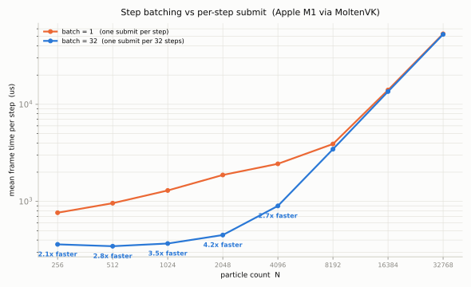

# Bottleneck found and fixed: one submit + fence per step

## What the profiler showed

Running `--report` at several particle counts, the frame breakdown had a
consistent shape at small and medium N:

```
              gpu_total    frame_total   frame - gpu_total
N = 1024        705 us       1296 us          591 us
N = 2048       1216 us       1872 us          656 us
N = 4096       1703 us       2438 us          735 us
```

`frame_total - gpu_total` — wall-clock time the step spends *not* executing
GPU work — was **~0.6 ms and roughly flat in N**. `submit_us` (time inside
`vkQueueSubmit`) accounted for only ~120–160 µs of it; the rest was the
`vkWaitForFences` wall time in excess of the GPU's own timestamped span,
i.e. **queue-submission plus fence-signal latency**, paid once per step.

## Root cause (precise)

The simulation loop recorded **one command buffer per step**, submitted it
with **one `vkQueueSubmit`**, and then **blocked on a per-submit fence**
before recording the next step. Every one of the 200 steps in a run paid the
full CPU→driver→GPU→fence→CPU round-trip. On this MoltenVK/Metal setup that
round-trip is ~0.4–0.5 ms and, being a fixed per-submit cost, it does not
shrink with workload — so at small N it was 40–50% of the frame.

The first thing tried — hoisting `vkAllocateCommandBuffers` /
`vkCreateFence` / `vkMapMemory` out of the loop (reuse one command buffer,
one fence, a persistent mapping) — was kept because it is correct and would
matter on a native driver, but on MoltenVK it was **within noise**: the cost
was in the submit/signal path, not object creation.

## Fix

`runBatch(K)` records **K simulation steps into one command buffer** and
issues **one submit + one fence wait** for the whole batch. Within the batch,
step *k*'s `integrate` is separated from step *k+1*'s `force_calc` by a
`COMPUTE_SHADER → COMPUTE_SHADER`, `SHADER_WRITE → SHADER_READ` pipeline
barrier on the particle buffer — the same write→read hazard that a host
round-trip was implicitly covering, now expressed as an in-queue
dependency. The device→host readback copy happens once, after the last step
in the batch. `--batch K` exposes it (default `1`).

The recorded command stream for K batched steps is identical to K separate
single-step submits, so the simulation result is **bit-identical** — the
Phase 8 self-test runs batch=1 vs batch={16,25,32} and asserts
`max |Δ| == 0` on every particle component.

## Before / after (Apple M1 via MoltenVK, 200 steps, mean frame time / step)

| N     | batch = 1 | batch = 32 | speed-up | note |
|-------|-----------|-----------:|---------:|------|
| 256   | 765 µs    | 361 µs     | 2.1×     | overhead-bound |
| 512   | 959 µs    | 346 µs     | 2.8×     | overhead-bound |
| 1024  | 1296 µs   | 368 µs     | 3.5×     | overhead-bound |
| 2048  | 1872 µs   | 451 µs     | 4.2×     | overhead-bound |
| 4096  | 2438 µs   | 899 µs     | 2.7×     | mixed |
| 8192  | 3903 µs   | 3451 µs    | 1.13×    | approaching compute-bound |
| 16384 | 14040 µs  | 13544 µs   | 1.04×    | compute-bound |
| 32768 | 53224 µs  | 52549 µs   | 1.01×    | compute-bound |



The fixed ~0.5 ms per-step round-trip is amortised over the batch, so
frame-time-per-step drops toward the GPU's actual work rate. The win is
largest (up to **4.2×**) in the regime where that round-trip dominated —
N ≤ 2048 — and vanishes above N ≈ 8192, exactly where the Phase 7 sweep
showed the O(N²) force kernel taking over the frame. There is nothing left
to amortise once the GPU is the bottleneck.

## Caveat on batched profiling

At large batch *and* large N the between-dispatch timestamps inside a batch
absorb queue-scheduling latency (32 heavy kernels stacked back-to-back), so
per-*stage* numbers get noisy there. Use `--batch 1` for accurate per-stage
attribution; use `--batch K` to measure and tune throughput. The
frame-time-per-step figure stays meaningful at any batch size.
